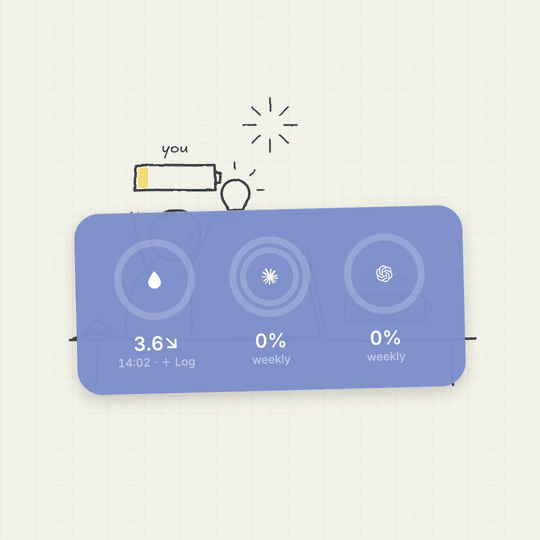

<div align="center">

# human-quota

**Claude has a quota. So do you.**

An iPhone widget that puts your AI's quota and yours side by side: Codex and Claude limits next to your blood sugar.

[](LICENSE)
[](https://scriptable.app)
[](https://github.com/steipete/CodexBar)

Works with Codex · Claude · any CodexBar provider · optional CGM glucose via Nightscout

</div>



▶︎ [Watch the 30-second video (with sound)](docs/human-quota.mp4)

## What it helps with

| You think | What the widget shows |
|---|---|
| "Am I about to hit a Claude limit?" | The Claude ring: outer ring = weekly window, inner ring = 5-hour window. The number below is the lower of the two, the limit that stops you first. |
| "How much Codex is left?" | One ring and one number: Codex has only a weekly limit, so that is what you get. |
| "Should I slow down yet?" | The iOS Battery widget's colours: green, yellow at 20% left or less, red at 10% or less. |
| "I'll eat after this one task." | A blood-drop ring with your latest CGM glucose and trend arrow below it, coloured by time in range. (Optional, needs a CGM + Nightscout.) |
| "What did I even have for lunch?" | Tap the blood drop, say or type what you ate, and it lands on your Nightscout chart next to your glucose. |
| "Is this number current?" | Stale or failed quota shows `—` and an empty ring. Old glucose is dimmed and loses its arrow. |

Heavy AI users check their Claude quota all day and forget their own: blood sugar. You code through lunch because the 5-hour window is about to reset. human-quota puts your AI's mana bars and your own health bar in one glance, without opening a terminal or a settings page mid-task.

**Quota-only works for everyone.** Glucose needs a CGM feeding [Nightscout](https://github.com/nightscout/cgm-remote-monitor), so it stays optional. Glucose-only works too, without CodexBar.

## How it works

```
 iPhone (Scriptable: install.js runs the latest widget.js)
   │
   ├──► GitHub raw ── widget.js   (a saved copy is used when offline)
   │
   │  Tailscale (private, encrypted)
   │
   ├──► Mac: codexbar serve  ── GET /dashboard/v1/snapshot  (Bearer token)
   │        └─ CodexBar app keeps provider logins, cookies and Keychain access fresh
   │
   └──► Nightscout (optional) ── GET  /api/v1/entries/sgv.json   (latest glucose)
            ▲                    POST /api/v1/treatments         (notes you log)
            │
            └─ your CGM's Nightscout uploader or bridge
```

### Why it's built this way

The first version had its own Mac server: a background launchd job shelled out to a quota CLI, and the server scraped a CGM cloud directly. It kept breaking. The background job couldn't read the macOS Keychain, and the Claude CLI credentials needed a fresh login every couple of days.

The lesson: **don't own the messy auth layer.** The widget is now thin glue over two mature open-source projects that already handle everyone's messy environments:

- **[CodexBar](https://github.com/steipete/CodexBar)** (MIT, macOS 14+ and a Linux CLI) reads Codex, Claude and many other providers through OAuth, browser cookies or a CLI. `codexbar serve` exposes a token-protected JSON snapshot.
- **[Nightscout](https://github.com/nightscout/cgm-remote-monitor)** (AGPL-3.0) is the standard open platform for CGM data, and many CGM users already run it.

There is no server code of ours. No data leaves your devices except to services you already run.

## Quick start

You need a Mac that stays on, an iPhone with [Scriptable](https://scriptable.app) (free), and [Tailscale](https://tailscale.com) on both (the free personal plan works) so the phone reaches the Mac privately from anywhere. Skip step 1 or step 2 if you only want one half.

### 1. Quota via CodexBar

```sh
brew install --cask codexbar             # or download from GitHub releases
codexbar config enable --provider claude # Codex is enabled by default
```

Sign in to the providers you use (for example the `codex` CLI login, and claude.ai in your browser). Keep the CodexBar app running, ideally as a login item: it is the part allowed to show Keychain prompts and keep browser-cookie access fresh. Background processes are deliberately denied Keychain prompts.

Serve the snapshot on your tailnet IP:

```sh
CODEXBAR_DASHBOARD_TOKEN=<random> codexbar serve \
  --host $(tailscale ip -4) --port 8784 --allow-plain-http --identity redacted
```

- **Plain HTTP** is acceptable here only because Tailscale encrypts the link (WireGuard). CodexBar requires the explicit flag.
- **Use the IP directly.** CodexBar rejects requests whose Host header isn't its bind address. A reverse proxy only works if it rewrites Host, and Tailscale Serve doesn't.

To start it at login, copy [`mac/codexbar-serve.plist`](mac/codexbar-serve.plist) to `~/Library/LaunchAgents/`, replace `TAILSCALE_IP` and `TOKEN`, then run:

```sh
launchctl bootstrap gui/$(id -u) ~/Library/LaunchAgents/codexbar-serve.plist
```

### 2. Glucose via Nightscout (optional: needs a CGM)

**Already run Nightscout?** Admin Tools → Subjects → add a subject with the roles `readable` and `careportal`, and use its token.

**Self-host on the same Mac** (the author's setup): MongoDB Community via Homebrew; Nightscout 15.0.8 from git, installed with `npm ci --omit=dev`; environment `AUTH_DEFAULT_ROLES=denied` and `DISPLAY_UNITS=mmol`; bound to `127.0.0.1:1337`; exposed tailnet-only over HTTPS with `tailscale serve --bg --https=443 http://127.0.0.1:1337`.

**Getting CGM data in:** Nightscout supports most CGMs through community uploaders and bridges; see the [Nightscout documentation](https://nightscout.github.io/) for yours.

### 3. iPhone: paste install.js once, updates arrive by themselves

1. In Scriptable, create a new script and paste in [`install.js`](install.js). Don't paste `widget.js`; the loader fetches it.
2. Fill in the `SETTINGS` object at the top (see below) and run the script once in the app.
3. Add a Scriptable widget to your home screen in the **medium** size. Set **Script** to your script and **When Interacting** to **Run Script**.

## Settings

All settings live in the `SETTINGS` object at the top of `install.js`. Leave a URL empty and that part of the widget is hidden.

| Key | Default | What it does |
|---|---|---|
| `codexbarUrl` | `""` | Your `codexbar serve` address, e.g. `http://<tailscale-ip>:8784`. Empty hides the quota rings. |
| `codexbarToken` | `""` | The `CODEXBAR_DASHBOARD_TOKEN` you set on the Mac. |
| `providers` | `["claude", "codex"]` | CodexBar provider IDs to draw. Two fit next to glucose; up to three without Nightscout. |
| `nightscoutUrl` | `""` | Your Nightscout URL. Empty hides the glucose slot. |
| `nightscoutToken` | `""` | A token with the roles `readable` and `careportal`. |
| `units` | `"mmol"` | Glucose units: `"mmol"` (mmol/L) or `"mg/dL"`. |
| `background` | `"7183D2"` | Optional; not in `install.js` by default, add it to override. One hex colour for a flat background, or a list of two or more for a diagonal gradient. |

About `background`: Scriptable widgets can't be see-through (a transparent background renders as plain white), so there is no real frosted glass. The default lavender was measured on a real iPhone to render like iOS glass on a lavender wallpaper. To match your own wallpaper, set a colour: iOS lightens widget colours on the Home Screen, so pick one a bit deeper than the glass you want to match.

## What you see

A medium widget with up to three slots side by side, laid out like the iOS Battery widget: a ring with a white glyph in the centre and one number below. No names, no labels, no reset times.

- **You** (only with Nightscout): a blood-drop glyph in one full ring, coloured by the international consensus time-in-range bands: green 3.9–10.0 mmol/L, yellow 10.1–13.9, red below 3.9 or above 13.9. Below it, your latest glucose with a trend arrow, in mmol/L or mg/dL.
- **Claude:** two concentric rings. Outer = weekly window, inner = 5-hour window. The number is the lower of the two.
- **Codex:** one ring for its weekly window, since Codex currently has only a weekly limit. The number is the weekly % left.
- **Ring colours** are Apple's system colours as the Battery widget uses them: green `#34C759`, yellow `#FFCC00` at 20% left or less, red `#FF3B30` at 10% or less. iOS gives every widget the same Home Screen treatment, so they match a Battery widget sitting next to this one.
- **Provider glyphs** come from CodexBar and are embedded in `widget.js`. A provider without a glyph gets a generic SF Symbol.
- **Model-scoped extra windows** (e.g. a model-only weekly limit) are ignored in v1.
- **Stale data is never shown as current.** Quota older than 15 minutes or failed to load shows `—` with only the ring's track. Glucose older than 10 minutes, or unreachable, is dimmed with no arrow and an empty ring. A quota outage doesn't hide glucose, and vice versa.

**Logging a meal:** tap the blood-drop slot. Scriptable opens a native prompt, "What did you eat or drink?", so iOS dictation works. The note is saved as a Nightscout `Note` treatment and appears on the Nightscout chart next to your glucose. If saving fails, the note stays on the phone, and you can try again now or later. A retry never duplicates, because Nightscout upserts on `created_at` + `eventType`: the same 6-note batch posted 3 times still left 6 notes.

**Tapping anywhere else** re-runs the script and shows a fresh preview. The widget asks iOS to refresh every 5 minutes.

## Updates

`install.js` is a small loader. On every run it downloads the latest `widget.js` from this repo on GitHub, saves a local copy (`human-quota-widget.js` in Scriptable's library folder), and runs it. If the download fails, it runs the saved copy, so the widget keeps working offline. A download that fails to parse never replaces a working copy. You never need to re-paste anything to get updates.

**Trust note:** the loader runs code from this repo. If you want to review every change before it reaches your phone, pin a tag or fork the repo.

**Pinning a tag:** in `install.js`, edit `SOURCE` and replace `main` with a release tag:

```js
const SOURCE = "https://raw.githubusercontent.com/lucyleeai/human-quota/<tag>/widget.js";
```

For a fork, point `SOURCE` at your fork's `widget.js` instead.

## Testing

```sh
node test/smoke.mjs
```

Runs `install.js` (which downloads and runs `widget.js`) against a fake Scriptable runtime and canned API responses, with no network and no iPhone. It checks one number per slot (Claude shows the lower window, Codex its weekly), no names or window labels as text, yellow at 20% or less, green for healthy rings and in-range glucose, glucose under 3.9 mmol/L turning red, the loader's offline fallback, that a broken download never replaces the working copy, that a quota outage doesn't hide glucose and shows `—`, the empty-settings hint, and log posting.

## Limits

- **iOS decides when the widget refreshes.** The script asks for every 5 minutes; iOS doesn't guarantee it.
- **Claude may occasionally need you to reopen claude.ai in your browser,** because CodexBar reads it through browser cookies. The CodexBar app handles re-import, but it can't promise never.
- **Not a medical device.** Don't make treatment decisions from a widget.
- **Tested by one person** on one Mac mini and one iPhone so far.

## Credits

- [steipete/CodexBar](https://github.com/steipete/CodexBar) (MIT): quota reading, `codexbar serve`, and the provider glyphs embedded in `widget.js`
- [nightscout/cgm-remote-monitor](https://github.com/nightscout/cgm-remote-monitor) (AGPL-3.0): CGM data platform
- [Scriptable](https://scriptable.app): the iOS runtime for the widget

Demo video: voice-over generated with OpenAI gpt-audio and music with Google Lyria (both AI-generated); sound effects from Pixabay (Pixabay Content License) and synthesized locally; handwriting font [Excalifont](https://github.com/excalidraw/excalidraw) (SIL OFL 1.1).

## License

[MIT](LICENSE) © lucyleeai
